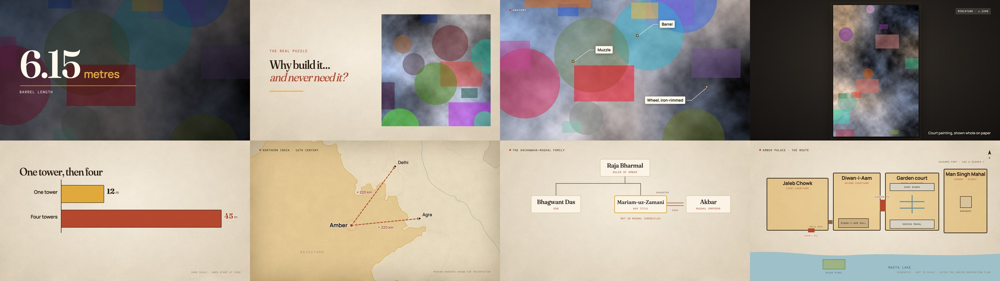

# turbomotion

**A Remotion replacement that doesn't open a browser.**

Describe a video as JSON. Get an H.264 MP4. In between, there is no Node, no React, no Chrome, no
screenshots: Rust draws every frame with [Skia](https://skia.org) on the Mac's GPU (Metal) and
pipes the pixels straight into the video encoder.



```
$ turbomotion render film.json --public public --assets assets --out film.mp4
7503 frames in 36.3s = 207 fps (3 workers)
```

|  | Remotion 4.0 | turbomotion | |
|---|:---:|:---:|:---:|
| 7,503-frame film, same x264 settings | 178 s | **59 s** | **3.0× faster** |
| same film, hardware H.264 | 153 s | **36 s** | **4.2× faster** |
| CPU time burned (hardware encode) | 600 s | **220 s** | 2.7× less |
| Peak memory (hardware encode) | 7.2 GB | **1.4 GB** | 5.2× less |
| Output vs Remotion's (SSIM, per shot type) | | 0.975 – 0.991 | visually the same |

Each side was tuned to its best setting, both draw the same shots, and the harness that produced these
numbers is in this repo. [How the test was run](#how-we-measured) · [Why it is faster](#why-is-it-faster)
· [What it won't do](#what-it-will-not-do-read-this-before-getting-excited)

---

## Why this exists

I make narrated explainer films: a photo with a slow camera move, a big number, a map that draws a
route, a diagram that builds itself in time with the voiceover. Remotion was how I made them, and
Remotion is genuinely great. But my 10-minute film took **forty minutes to render**, and I render
a film dozens of times while I fix a label here and a timing there. The wait was the whole loop.

Remotion works by driving a real web browser: for each frame it asks Chrome to lay out and paint a web
page, screenshots it as a JPEG, hands that to Node, which hands it to ffmpeg, which decodes the JPEG so
it can encode it again. It is a wonderfully general design, because anything a browser can draw is a
valid video. It is also a lot of machinery to fetch a handful of rectangles, some text and a photograph.

So I wrote down what my films actually contain (eight kinds of shot) and taught Rust to draw exactly
those, with the same fonts, easing curves and animation quirks, frame for frame.

## What it is

A renderer for a small, fixed vocabulary of shots, described by a `film.json`:

| shot | what it draws |
|---|---|
| `photo` / `illustration` | a photo with a camera move and a **depth-map parallax** (a SkSL shader), plus pins and captions |
| `stat` | a huge number that counts up over a photo, with a unit and a label |
| `card` | big typography on paper, optionally over a photo |
| `painting` | a miniature or artwork shown whole on a paper backdrop |
| `compare` | animated bars that compare quantities |
| `map` | Natural Earth outlines, rivers, routes, rings, pins and labels, under a keyed camera |
| `diagram` | 7 hand-built animated explainers (a water lift, a cooling system, …) that build step by step |
| `plan` | an architectural plan that reveals itself, with highlights and marks |

Everything animates on **cues**: moments in the narration (`"cueTimes": [1.4]` means "the word
*metres* is spoken 1.4 s into this shot"). The renderer doesn't know any words; it just makes things
happen when told.

A complete film file:

```json
{
  "fps": 30, "width": 1920, "height": 1080, "durationInFrames": 150,
  "chapters": [{ "title": "Hello", "startFrame": 0 }],
  "assets": {
    "tower": { "file": "photos/tower.jpg", "kind": "photo", "depth": "depth/tower.png" }
  },
  "shots": [{
    "id": "s001", "type": "stat", "args": ["tower"],
    "params": { "value": "6.15", "unit": "metres", "label": "barrel length", "from": "0.5,0.5,1", "to": "0.5,0.5,1.18" },
    "startFrame": 0, "durationInFrames": 150, "duration": 5.0, "cues": 1, "cueTimes": [1.4]
  }]
}
```

An unknown shot type or parameter is a hard error before any work starts. There are no silent fallbacks.
(`examples/hello.json` is the file above; `bench/corpus/film.json` has 41 shots covering every type and
variant.)

## Quick start

You need an Apple Silicon Mac, [Rust](https://rustup.rs) (the pinned 1.89 toolchain installs itself)
and `ffmpeg` on your path.

```bash
cargo build --release

./target/release/turbomotion render examples/hello.json \
    --public bench/corpus/public --assets assets --out hello.mp4
```

Other commands:

```bash
turbomotion render  film.json … --codec software --crf 17     # x264 instead of the hardware encoder
turbomotion render  film.json … --from 300 --to 600          # just a range
turbomotion stills  film.json … --dir stills/                  # one PNG per shot, for review
turbomotion qa      film.json … --report qa.json              # text-overflow, overlap and determinism checks
```

`qa` is worth a mention: because the renderer owns the text layout, it can *measure* it. It records every
text box that is actually visible and reports any that cross the safe margin or collide with another.
It catches the sort of mistake you only notice at 2 a.m. on the final export.

## How it works

```
film.json ──► scene per shot ──► Skia canvas on a Metal GPU surface ──► raw BGRA pixels ──► ffmpeg ──► .mp4
              (prepared once:                                           (one memcpy,        (hardware or
               fonts, textures,                                          no JPEG)            x264)
               laid-out text)
```

- **Prepare once, draw anywhere.** Each shot loads its textures, shapes its text and builds its vector
  scene one time, and then it can draw *any* instant of itself. Frames don't depend on each other.
- **Parallel by slicing.** The frame range is cut into N segments. Each worker owns its GPU context and
  its own ffmpeg, and writes a segment; the segments are joined with a stream-copy concat (no re-encode).
- **Diagrams are a retained scene graph.** Nodes carry their entrance (`fade`, `up`, `pop`, `draw`) and
  the step or cue that triggers it, so "what is on screen at 3.2 s" is a pure function of time.
- **It reproduces its predecessor's quirks on purpose.** GSAP's `drawSVG` at 0 % draws nothing in
  Chrome; a GSAP scale-from-0.6 tween on an SVG element leaves the element permanently offset by a few
  pixels. Those are *bugs*, and they are reproduced, because the goal was a 1:1 replacement and
  `bench/remotion/` is the reference it is checked against.
- **Deterministic.** Rendering a frame twice gives the same pixels (checked on every benchmark run, for
  both renderers).

Source map: `src/shots/` (one file per shot type), `src/text.rs` (Skia text layout), `src/photo.sksl`
(the parallax shader), `src/render.rs` + `src/encode.rs` (workers and the ffmpeg pipe), `src/review.rs`
(the QA).

## Why is it faster?

Count what has to happen for **one frame**.

**Remotion** (per frame):
1. set the timeline, let React re-render, wait for the DOM to settle
2. Chrome lays out and rasterises the page
3. the GPU result is read back and **JPEG-encoded** inside Chrome
4. the JPEG crosses a process boundary into Node
5. ffmpeg **decodes the JPEG** into pixels again
6. ffmpeg encodes H.264

**turbomotion** (per frame):
1. Skia draws display lists into a Metal surface
2. read the pixels back (raw BGRA)
3. ffmpeg encodes H.264

Two whole stages vanish (the browser's layout engine and the JPEG round trip), and so does the second
copy of the pixels. That is why it uses **2.7× less CPU** and **5× less memory** even at the same output
spec: Chrome, a JavaScript heap and five browser processes are simply not there.

The speed-up also depends on the encoder, and the table above shows both so nobody has to guess:

- With **software x264** on both sides the CPU encoder competes with drawing for the same cores, so the
  gap is "only" **3×**.
- With the **Mac's hardware encoder**, encoding costs almost nothing and native is limited by how fast it
  can draw: **4.2×**. Remotion barely moves (178 → 153 s) because its time is the *browser*, not the encoder.

On the draw side alone, one worker with one tab each: native runs 47–65 fps, Remotion about 14 fps.

## How we measured

Both renderers render the **same `film.json`** (`bench/corpus/film.json`: 41 shots, all eight types,
7,503 frames, 1920×1080 at 30 fps) to the same silent H.264 spec. Neither side gets a free lunch.

- **Tuned, not default.** Each renderer's parallelism was swept first and then used at its best.
  Native: 1, 2, 3, 4, 6 workers; best 6 (102 fps on the sweep slice). Remotion: seven combinations of
  browsers × tabs; best 5 browsers × 2 tabs (35 fps). Note Remotion's own advice to add tabs *hurts* here:
  1 browser × 10 tabs is slower than 1 browser × 1 tab (9.9 vs 15.1 fps). Spreading over separate
  browsers is what helps.
- **Same encoder settings.** x264 `crf 17 preset faster` on both, or VideoToolbox at 20 Mbit/s on both.
- **Whole-process measurements.** Wall time, CPU time of the *entire process tree* (including every
  Chrome helper and ffmpeg), and peak resident memory of the tree, sampled every 0.25 s.
  Remotion's bundling and browser start-up are inside its numbers. (The per-type and sweep tables below
  use the render stage only; setup is ~1.5 s on that side.)
- **Alternating runs, repeated.** Native and Remotion alternate so thermal drift hits both. Per-type
  runs are the median of 3; the native full-film numbers are the median of 3; the Remotion full-film
  runs are **one run each** (each is 2.5–3 minutes, and run-to-run variation on the native side was within about 5 %).
- **Same Chrome the production films used**, installed Google Chrome with ANGLE/Metal, because
  Remotion's bundled headless shell doesn't start reliably on this Mac. It is a real-world setting,
  not a handicap, but it is the setting.

### Results

Machine: Apple M5 (10 cores), 24 GiB, macOS 26; Google Chrome 155, Remotion 4.0.538, Node 24, ffmpeg 4.4.

**Per shot type**, 150 frames each, one worker / one browser, x264 on both:

| shot type | native fps | Remotion fps | speed-up | SSIM vs Remotion |
|---|:---:|:---:|:---:|:---:|
| stat | 53 | 13.9 | **3.8×** | 0.989 |
| card | 57 | 14.2 | **4.0×** | 0.985 |
| photo | 52 | 13.8 | **3.8×** | 0.975 |
| painting | 58 | 14.4 | **4.1×** | 0.988 |
| compare | 65 | 14.7 | **4.4×** | 0.991 |
| map | 47 | 14.2 | **3.3×** | 0.984 |
| diagram | 64 | 14.4 | **4.4×** | 0.991 |
| plan | 64 | 14.4 | **4.5×** | 0.990 |

Remotion costs the same ~14 fps whatever it draws, because the browser round trip dominates. Native
varies with the shot (maps are heavy: they stroke thousands of geographic paths).

**Parallelism sweep**, a 900-frame mixed slice, x264:

| renderer | parallelism | fps |
|---|:---:|:---:|
| native | 1 worker | 64.4 |
| native | 2 workers | 87.9 |
| native | 3 workers | 95.6 |
| native | 4 workers | 99.2 |
| native | 6 workers | **102.3** |
| Remotion | 1 browser × 1 tab | 15.1 |
| Remotion | 1 browser × 5 tabs | 10.8 |
| Remotion | 1 browser × 10 tabs | 9.9 |
| Remotion | 2 browsers × 4 tabs | 21.7 |
| Remotion | 3 browsers × 3 tabs | 32.2 |
| Remotion | 3 browsers × 4 tabs | 30.4 |
| Remotion | 5 browsers × 2 tabs | **35.2** |

**The whole corpus**, each side at its best setting:

| encoder | Remotion | turbomotion | speed-up | CPU-seconds (Remotion / native) | peak RAM (Remotion / native) |
|---|:---:|:---:|:---:|:---:|:---:|
| x264 | 178 s (43 fps) | 59 s (127 fps) | **3.0×** | 913 / 431 | 8.5 GB / 3.9 GB |
| hardware | 153 s (50 fps) | 36 s (207 fps) | **4.2×** | 600 / 220 | 7.2 GB / 1.4 GB |

The raw numbers are in [`bench/results/m5.json`](bench/results/m5.json).

### On a real film

My production film (a 10.6-minute, 19,122-frame, 103-shot documentary, with real photographs that
can't ship in this repo) renders in **111 s** with the hardware encoder. The same film took
**40 minutes** in Remotion when I first built it. That gap (about 21×) is much bigger than anything
above, and you should **not** read it as the speed-up: that Remotion run used a 3-worker chapter split
I never swept, at about 8 fps, and the hardware encoder had not been tried on that side. Tuned the way
the benchmark tunes it, Remotion would have landed nearer 7 minutes, so the real gap is closer to 4–5×. I include it because
it's what I lived through, and because the tuned, same-spec comparison above is the honest one.

### Does it look the same?

Yes. Shot for shot against Remotion's own frames:


<sub>Left: Remotion. Right: turbomotion. One of 41 shots.</sub>

`python3 bench/parity.py` compares native stills to frozen Remotion stills (SSIM ≥ 0.93 required):
**41/41 pass, median SSIM 0.991, worst 0.976** (a map, whose labels render a hair lighter than
Chrome's). On video, SSIM against Remotion's output is 0.975–0.991 per shot type; the differences are
mostly h264 noise and anti-aliasing at the pixel level. "Equal" is the claim. I haven't made it *prettier*
than Remotion, and I'd be suspicious of anyone who says they have.

## What it will not do (read this before getting excited)

- **It is not a general Remotion.** You can't point it at a React component. Eight shot types, in Rust.
  A ninth means writing Rust. If you need arbitrary web content in your video, use Remotion; that
  generality is exactly what it pays for in speed.
- **Apple Silicon only, today.** It draws with Metal and uses VideoToolbox for the fast path. The Skia
  layer is portable (Vulkan/Vulkano or the CPU raster path would work), but nobody has done that work.
  `--codec software` encodes on the CPU anywhere ffmpeg runs, but the draw step still wants Metal.
- **It renders silent video.** Narration, music and the final mix happen elsewhere (I do it with ffmpeg).
- **It reads a `film.json`; it doesn't make one.** The pipeline that turns a script into timed cues
  (voice, alignment, cue placement) isn't in this repo. The schema is small, and the example above is a
  complete file.
- **One machine, one chip.** Everything here was measured on a single M5. Ratios should travel better
  than absolutes, but I haven't run it on anything else.

## Reproduce the benchmark

```bash
cargo build --release
( cd bench/remotion && npm install )          # Remotion + React + GSAP, benchmark only
python3 bench/make_corpus.py                  # (images are committed; this regenerates them)

python3 bench/compare.py types sweep full quality --reps 3 --out bench/results/mine.json
python3 bench/report.py bench/results/mine.json    # markdown tables
python3 bench/parity.py                       # visual parity against frozen Remotion stills
```

`bench/compare.py` takes about 35 minutes (Remotion is the slow side). `bench/remotion/` is a standalone
Remotion project containing the same eight shots in TSX; it is also the reference the Rust code was
ported from, and the Rust source cites it by path.

Remotion has its own license; see [remotion.dev/license](https://www.remotion.dev/license) if you use
that folder commercially.

## Layout

```
src/                  the renderer (≈6k lines of Rust)
assets/               fonts, paper and grain textures, Natural Earth map data
examples/hello.json   the smallest complete film
bench/corpus/         the synthetic benchmark film and its (generated) photographs
bench/remotion/       the Remotion reference implementation
bench/compare.py      the head-to-head harness
bench/parity.py       visual parity against Remotion
bench/golden/         the frozen Remotion stills
```

## Credits

Fonts are [Fraunces](https://github.com/undercasetype/Fraunces), [Manrope](https://github.com/sharanda/manrope)
and [IBM Plex Mono](https://github.com/IBM/plex) (all SIL Open Font License; licenses in `assets/fonts/`).
Map data is derived from [Natural Earth](https://www.naturalearthdata.com) (public domain). Built on
[skia-safe](https://github.com/rust-skia/rust-skia).
