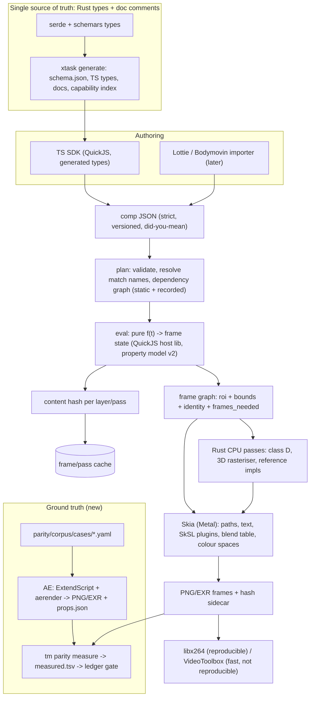

# Research review: the best known way to build an After Effects parity platform, and how turbomotion compares

Date of research: 2026-10-27. Written by a research-only pass: nothing in `turbomotion/` was built or edited except this file.
Local state read: `docs/ARCHITECTURE.md`, `docs/BUILD_PLAN.md`, `parity/specs/*`, `wp/*/REPORT*.md`, `parity/*.tsv`, git head `e417193`
(WP-02, WP-10, WP-13 and the output dither had landed while I was reading; the tree is moving, so numbers below are a snapshot).

How to read the tags:

* **[F]** fact, from a primary source (vendor docs, spec, source code, release notes) that I read.
* **[S]** secondary or community source, or a project's own claim about itself. Useful, not proof.
* **[I]** my inference. Reasoned from facts, not stated by any source.
* **[U]** unverified. I could not confirm it, or only saw it in a search summary. Do not build on it without checking.

Cost scale: S = a day or two, M = about a week, L = several weeks, XL = a quarter or more. Risk is the chance the item fails or
has to be redone: low / medium / high.

---

## 0. Executive summary (15 lines)

1. **Verdict: the architecture is on the right path; do not rebuild it.** Frame as a pure function of time, a strict typed schema, layer-space effects with declared growth, one blend table, an honest parity ledger and Skia as the 2D engine are all choices that comparable systems converge on.
2. **The gap is measurement, not design.** No number anywhere in turbomotion has been measured against After Effects (86% of "ready" verdicts are unprobed; the AE-dump test is `#[ignore]`d). "Parity" is currently a claim, and the plan's own wording ("the goal is not pixel-matching AE") makes it unfalsifiable.
3. **Top recommendation: build the AE ground-truth corpus now (S to M).** The owner has AE. ExtendScript builds cases, `aerender` renders them to PNG/EXR, ExtendScript dumps property values. Section 5 has the script outline and a tolerance policy.
4. **Two disputes are already visible.** turbomotion chose Gaussian Blur `sigma = blurriness/2` and marks it UNSURE; Skia's Skottie ships `kBlurSizeToSigma = 0.3`. That is a 40% disagreement on the most-used effect. A single measured edge profile settles it.
5. **Make measurement a gate (S).** Add `measured`, `tol_class`, `err_p999`, `ae_version` columns to the ledger; "done" requires a measurement or an explicit waiver.
6. **Colour: keep what you have; it already matches AE's default.** AE with colour management off blends display-encoded numbers; `linear_light` is AE's "Blend Colors Using 1.0 Gamma"/Linearize. Half-float intermediates are enough for 8/10-bit output. Do not adopt OCIO/ACES for parity (it buys none).
7. **Effects: keep single-file SkSL plugins; do not adopt OpenFX** (AE does not load OpenFX). Borrow the vocabulary every host agrees on and you lack: a region-of-interest declaration, `identity`, `frames_needed`, and key effects by AE **match name** (`ADBE Gaussian Blur 2`), as Skottie and Lottie do (M).
8. **Add a content-hash layer/pass cache (M).** Natron, EffectCraft and AE itself cache by a hash of evaluated inputs. Your eval stage is already pure numbers, so the key is cheap. It also becomes a determinism check.
9. **Expressions: stay on QuickJS, but design for dependency recording and for statistical parity on randomness.** AE's `wiggle`/`random` seed from an internal layer id; only `seedRandom(n, true)` forms can be matched, and only by measuring AE's generator (L, medium risk).
10. **Schema: today there is no single source of truth** (hand-written TS types guarded by drift tests; no schemars/ts-rs/specta). Generate JSON Schema, TS types, docs and the catalogue from the Rust types (M); keep the drift tests as a second guard.
11. **3D: the CPU-rasteriser plan is sound for AE Classic 3D** (AE intersects 3D layers within a contiguous group; a 2D layer, adjustment layer or layer style breaks the group). Do not chase Advanced 3D or the Cinema 4D renderer (XL, no payoff).
12. **Do not chase** Roto Brush, Warp Stabilizer, Content-Aware Fill, Mocha, Trapcode/Element: industry practice (Skottie ~30 effects, Lottie spec excludes effects and expressions) is an explicit scope cut. Accept baked data (tracks, mattes) instead.
13. **Determinism: compare frames, not video.** Hash PNG/EXR output; software `libx264` for any video that must be byte-stable; VideoToolbox is not byte-stable. EffectCraft pins its simulation hashes per macOS release because libm differs. Expect the same.
14. **Biggest risks:** the first AE measurement reveals broad deviations (colour/blur/blend) and forces rework; AE internals that are undocumented (Glow, Fractal Noise, wiggle) can only be matched by fitting; macOS/Skia version lock; breadth (~205 effects) outrunning depth.
15. **Where I disagree with the plan:** change the goal from "not pixel-matching" to "within a declared tolerance of AE on a defined corpus, per feature, recorded in the ledger". Everything else follows from that sentence.

---

## 1. How real compositing and motion engines structure the render core

### Findings

| System | Core idea | Evidence |
| --- | --- | --- |
| After Effects SmartFX | Two-phase effect: **pre-render** (the effect says which input rectangles and frames it needs and what rectangle it returns) then **render**. `result_rect` is request-dependent; `max_result_rect` is not. Effects that draw outside their input declare extra pixels. | [F] <https://ae-plugins.docsforadobe.dev/smartfx/smartfx/> |
| Nuke | Pull model on `Iop`: `_validate` (compute the output info / bounding box), `_request` (declare what you need from inputs), `engine` (produce scanlines or tiles). | [F] <https://learn.foundry.com/nuke/developers/latest/ndkdevguide/2d/architecture.html> |
| OpenFX / Natron | Same split as a standard action set: `getRegionOfDefinition`, `getRegionsOfInterest`, `getFramesNeeded`, `isIdentity`, `render`. Natron's host recurses `renderRoI`, looks results up in an LRU cache keyed by a 64-bit hash of parameters, input hashes, time, view, scale and region, so invalidation needs no dirty flags. | [F] OFX actions: <https://openfx.readthedocs.io/en/main/Reference/ofxRendering.html>, <https://github.com/NatronGitHub/Natron/wiki/OpenFX-plugin-programming-guide-%28Basic-introduction%29>. [S] cache description: <https://natron.readthedocs.io/en/rb-2.6/maintainers/rendering.html> (reads like a generated summary of the source; treat as [S]) |
| Blender compositor | "Infinite compositing space": every image has a transform and a Domain; each node runs on an Operation Domain; missing input is zero/transparent. GPU compositor since 3.5, expected to match the CPU one. | [F] <https://docs.blender.org/manual/en/latest/compositing/compositor_system.html>, <https://docs.blender.org/manual/en/4.0/compositing/realtime_compositor.html> |
| Resolve Fusion | Region of interest intersected with a data window ("DoD"); Fuses (script plugins) and compiled plugins share it. | [S] Blackmagic Fuse Plugin Guide, June 2023; I did not retain the URL. Overview: <https://www.blackmagicdesign.com/products/davinciresolve/fusion> |
| Skottie (Skia) | Lottie player over a scene graph (`sksg`). **Effects are looked up by AE match name** in one sorted table (`ADBE Gaussian Blur 2`, `ADBE Fill`, ...). About 30 effects. Unsupported layer effect: log a warning and continue. | [F] `Effects.cpp` <https://raw.githubusercontent.com/google/skia/main/modules/skottie/src/effects/Effects.cpp> |
| Lottie spec | Open spec of the *document*: layers, shapes, keyframes. Effects and expressions are documented outside the core spec (community docs). | [F] <https://lottie.github.io/lottie-spec/latest/specs/layers/>, <https://lottiefiles.github.io/lottie-docs/effects/> |
| Remotion | A frame is a pure function of the frame number; video is just N independent renders. | [S] <https://www.remotion.dev/docs/the-fundamentals>; [F] concept |
| MLT, Olive, Glaxnimate, Synfig, Friction, Cavalry, Rive, Motion Canvas | Editor/runtime frameworks; useful as scope maps, not as render-core models. Cavalry, Friction, Skottie use Skia. Rive ships its own renderer. | [S] <https://www.mltframework.org/docs/>, <https://github.com/olive-editor/olive>, <https://github.com/KDE/glaxnimate>, <https://github.com/synfig/synfig>, <https://docs.cavalry.scenegroup.co/>, <https://github.com/Rive-app/rive-runtime>. I did not read Flame or Synfig internals ([U]) |
| Vello | 2D renderer on wgpu compute. CPU path mature, GPU path early; filter graphs not implemented as of the releases I read. | [F/S] <https://github.com/linebender/vello/releases> |
| **EffectCraft** (the closest comparable) | Rust, alpha, created 2026-10-01, Apache-2.0. Layered crates enforced by `cargo xtask`; a CPU reference renderer **and** a wgpu compute GPU path tested against the CPU oracle; layer cache keyed by an evaluated-input hash; integer-tick time; one property tree; schema versioning with upgrade functions. | [S] <https://github.com/storytold/effectcraft> (docs: `docs/architecture.md`, `docs/effects-parity.md`, `docs/testing.md`, `docs/gaps.md`, `docs/fidelity/`). Self-reported; created 26 days ago, so star count (about 8k) says nothing about quality |

### Recurring patterns, and where turbomotion stands

| Pattern | Seen in | turbomotion | Essential for AE parity? |
| --- | --- | --- | --- |
| Frame is a pure function of time | Remotion, EffectCraft | **Has it** (principle 1) | Yes (enables hashing, farms, seek==play) |
| Document model separate from renderer, headless | all | **Has it** (schema → plan → eval → render) | Yes |
| Bounds *growth* declared by the effect (RoD) | AE, Nuke, OFX | **Has it** (`@bounds`, `effect_space: layer`, growth summed along the chain) | Yes |
| Top-down **region of interest** (render only what is asked) | AE SmartFX, Nuke `_request`, OFX, Natron, Fusion, Blender | **Missing.** Whole layer buffers plus growth; no request rectangle | No for final frames; yes for tiled/large comps and cheap previews |
| **Identity** short-circuit (`isIdentity`) | OFX, Natron | Partial: per-effect "off" checks by convention, no declared hook | Nice to have (speed) |
| **Frames-needed** declaration for temporal effects | OFX, Natron, SmartFX | Partial: `history` inputs, refused in layer space | Yes (echo, time displacement, motion blur) |
| **Content-hash cache** of intermediate images | Natron (Hash64), EffectCraft, AE (layer cache) | **Missing** (the 512 MiB `Cache` in `render/history.rs` holds history levels only) | Not for parity; large for throughput and for determinism checks |
| Float linear working space + managed colour | Nuke, Natron, Blender, AE 32 bpc | Half-float + Skia colour spaces; opt-in linear | Only to the extent AE uses it (see section 3) |
| CPU **reference** implementation as oracle for GPU kernels | EffectCraft | Missing (SkSL is the only implementation for most effects) | Strongly useful for correctness; costly |
| Effects keyed by AE **match name** | Skottie, Lottie, py-aep | `parity/effects.tsv` keys by display name; no match-name column [I from header] | Yes, if you ever import AE data or compare against it |

### Take

[F] Every mature host separates "what rectangle can you produce" from "what rectangle do you need". turbomotion has the first half. [I] The second half (ROI) matters less for a final-frame batch renderer than for an interactive host, so its absence is not a parity blocker; the missing hash cache and the missing identity/frames-needed hooks are cheaper and pay more.

### RECOMMENDATION

* **Keep** pure-function frame, layer-space bounds, staged pipeline. Risk low.
* **Adopt** `@roi` (default = render window; blur declares its reach), `@identity` (a parameter predicate in the header, so no Rust needed), and `@frames_needed` (history/echo) in the plugin header grammar. Cost M, risk low. Do it in the same work package as the match-name column.
* **Adopt** a content-hash cache (see section 7). Cost M, risk low.
* **Defer** a request-rectangle (tiling) refactor. Cost L, risk medium. Only needed for 8K or interactive previews.

---

## 2. Effects as a standard: OpenFX vs SkSL DSL vs ISF/GLSL/WGSL/Slang

### Findings

* [F] **After Effects does not load OpenFX.** AE uses its own C/C++ SDK; vendors ship two builds for AE and OFX hosts. <https://aescripts-or-author-wiki.gitbook.io/author-wiki/technical-guidelines/choosing-your-technology> (aescripts vendor wiki; [S]-grade but consistent with Adobe's SDK docs).
* [F] OpenFX 1.5 has a GPU render suite (Metal, CUDA, OpenCL). <https://openfx.readthedocs.io/en/main/> (reference index lists `ofxGPURender.h`). [S] The Rust bindings I found are immature or stale (the `ofx` crate targets 1.4 and dates from 2019; the `openfx` crate listings were inconsistent) [U].
* [F] **ISF** (Interactive Shader Format) is exactly turbomotion's header-comment idea, standardised: a JSON header in a comment, then GLSL. `INPUTS` (float, color, image, point2D ...), `PASSES` with `TARGET`, `PERSISTENT` (cross-frame buffer) and `FLOAT` (32-bit buffer). <https://docs.isf.video/ref_json>, <https://docs.isf.video/ref_multipass>. This is independent confirmation that "one file = metadata header + shader body" is a sound plugin format.
* [F] **Slang** (Khronos, since 2024-11): one source to SPIR-V, MSL, WGSL, HLSL, GLSL, CUDA, CPU; the Metal and WGSL back-ends are still marked experimental in the repo README. <https://github.com/shader-slang/slang>, <https://www.khronos.org/news/press/khronos-group-launches-slang-initiative-hosting-open-source-compiler-contributed-by-nvidia>
* [F] **naga** (wgpu's translator): WGSL/SPIR-V/GLSL in, SPIR-V/MSL/HLSL/WGSL out; a translator, not an authoring language. <https://crates.io/crates/naga/22.1.0>
* [F] **SkSL** is a restricted GLSL ES2 dialect: no compute shaders, constant-bounded loops only, no non-constant array indexing; the runtime-effect header documents the restrictions. <https://skia.org/docs/user/sksl/>, <https://github.com/google/skia/blob/main/src/sksl/README.md>. Skia Graphite (the new backend) is still moving; skia-safe's support is early [S].
* [F] **wgpu**: `Rgba16Float` storage works; 32-bit float filtering/blending are behind feature flags (`FLOAT32_FILTERABLE`, `FLOAT32_BLENDABLE`); some f32 atomics are gated. <https://docs.rs/wgpu-types/latest/wgpu_types/struct.Features.html>, <https://docs.rs/wgpu-types/latest/wgpu_types/enum.TextureFormat.html>
* [F] **Skottie's effect set** is ~30 effects, all expressible as SkSL/image filters (blur, fill, tint, tritone, levels, hue/sat, displacement, fractal noise, corner pin, sphere, wipes...). <https://raw.githubusercontent.com/google/skia/main/modules/skottie/src/effects/Effects.cpp> This is the best available evidence that a large, *useful* fraction of AE's effects fit in a fragment-shader model.
* [S] **Rive** moved to its own renderer with procedural feathering and a WGSL canvas; **Vello** is the pure-GPU path. Neither is a drop-in for text, paths and blend-mode compositing at turbomotion's maturity.

### Take

[I] What does SkSL *not* cover among AE effects? Anything needing scatter (histograms, auto-levels, some particle systems), FFT-based work, large irregular neighbourhoods (bilateral at large radius, median), cross-frame reduction, and mesh/3D raster. turbomotion's plan already routes these to "class D" (Rust CPU). That is the right split. The risk is not SkSL's limits; it is that the CPU class has no oracle and no speed budget.

[I] Skia vs wgpu vs hybrid. Switching the 2D engine (text shaping, path ops, image filters, blend modes, colour spaces, F16 surfaces, Skottie) to wgpu/Vello means rebuilding things Skia already does and gives up Skottie as a reference implementation. That is XL work to gain Windows/Linux, which is out of scope. The credible future step is a **hybrid**: keep Skia for the scene and compositing, add compute passes (wgpu or the `metal` crate that `core` already depends on) for the few effects that need compute, sharing textures with Skia. Do not start it before the corpus says which effects actually need it.

### RECOMMENDATION

* **Keep** single-file SkSL plugins with the header. Risk low.
* **Do not adopt** OpenFX as the effect standard. There is no AE-parity payoff; the only benefit is hosting third-party OFX plugins, which is not a goal. Cost saved: XL.
* **Adopt** ISF's good ideas: an explicit `float`/persistent intermediate marker per pass (you have `@pass`; make the buffer format part of it), and typed parameter kinds (`color`, `point2D`, `image`) with ranges, checked at plugin-load time. Cost S.
* **Adopt** an optional CPU reference per effect (a Rust `fn` or a golden table) for the effects the corpus shows are wrong or disputed, not for all 205. Cost M, risk low.
* **Defer** wgpu/compute hybrid until a measured need exists. Cost XL, risk high.
* **Do not adopt** Slang or WGSL now: they pay off only with multiple GPU back-ends.

---

## 3. Colour: OCIO/ACES vs Skia colour spaces; glow/bloom; linear vs display; float; dither; HDR

### Findings

* [F] AE colour model. Colour management is **off by default** (working space "None"); then blending happens on the encoded numbers. Two opt-ins: *Linearize Working Space* (managed projects) and *Blend Colors Using 1.0 Gamma* (blend-only, affects opacity fades, motion blur and blend modes). Adobe says linear is best at 16/32 bpc and not recommended at 8 bpc. <https://helpx.adobe.com/after-effects/desktop/adjust-colors/color-management/color-management.html>
* [F] Depth: 8 bpc is 0 to 255; **16 bpc in AE is 0 to 32768 (a 15-bit-plus-one integer, not half-float)**; 32 bpc is float and keeps over-range values, "as useful for synthetic effects such as lights, blurs, and glows as for HDR footage". <https://helpx.adobe.com/after-effects/desktop/adjust-colors/color-basics/color-basics.html>
* [F] **Dithering:** AE dithers automatically when converting to 8 bpc for render/export, not for previews. Same page.
* [F] **GPU vs CPU:** "GPU-accelerated effects may render with small color precision differences in an 8-bpc project compared to CPU-only. Set the project to 16-bpc or 32-bpc for accurate results." <https://helpx.adobe.com/after-effects/desktop/render-and-export/basics-of-rendering-and-exporting/basics-rendering-exporting.html>. Implication for the corpus: AE itself has a noise floor at 8 bpc.
* [F] Output module: *Convert To Linear Light* defaults to on only for 32 bpc. Colour-management page above.
* [S, via EffectCraft] AE 8/16 bpc clamps and quantises after every effect; AE 26.5 added OCIO/ACES 2.0 config support. <https://github.com/storytold/effectcraft/blob/main/docs/effects-parity.md> path unverified; I read this in their parity page, not in Adobe's release notes [U].
* [F] **OCIO 2.5** (ACES 2.0 built-in configs, GPU shader generation for GLSL/HLSL/MSL and others). <https://opencolorio.org/> WGSL output not seen in what I read [U].
* [F] **Bloom/halation**: the standard real-time recipe is the Jimenez dual-filter pyramid (13-tap downsample with luma-weighted firefly suppression, 9-tap tent upsample); the physically based variant needs no threshold because HDR input already has the range. <https://www.iryoku.com/next-generation-post-processing-in-call-of-duty-advanced-warfare>; <https://learnopengl.com/Guest-Articles/2022/Phys.-Based-Bloom>. [U] AE's own Glow algorithm is undocumented.
* [Local fact] turbomotion: Skia colour spaces with an opt-in `color` block (`linear_light`, working profile sRGB/Display-P3), half-float surfaces, float-uniform colour workaround, no ACES, **now also output dither** (`color.dither`: none/ordered/blue_noise; static pattern). `parity/specs/dither.md`.

### Take

[F→I] turbomotion's **default (blend display numbers, `linear_light: false`) is AE's default behaviour.** Opt-in linear is AE's opt-in. So colour is not where parity is lost; "premium glow in linear" is a quality choice layered on top, which is fine if the ledger says so.

[I] Half-float is adequate for 8-bit and 10-bit delivery: near 1.0 it has 2048 steps per half-stop, and a 16-sample accumulation adds well under one 8-bit level of rounding. It is *coarser* than AE's 16-bpc integer near white (about 16x) and much finer in the darks. Where it will hurt: very large accumulations (many blend layers, long feedback chains, large-sigma blurs summed in several passes). Keep float32 as a per-pass opt-in, not a global switch.

[I] What "typed colour pipeline" means in practice: make the colour space part of the **type** of every image and colour value (`Rgba<Display>`, `Rgba<Linear>`, `Straight` vs `Premul`), and make conversions explicit functions. In Rust this is a zero-cost newtype; in SkSL plugins it is the `@space` header you already have. What to check: every effect declares what space it wants and the engine inserts conversions, never the plugin. You are most of the way there.

[I] OCIO/ACES buys nothing for AE parity (AE's default is none) and costs a large dependency. Revisit only if you want to *deliver* HDR/ACES.

### RECOMMENDATION

* **Keep** Skia colour spaces, opt-in linear, half-float default, output dither. Risk low.
* **Adopt** a corpus case that renders every blend mode in AE with *both* colour-management off and "Blend Colors Using 1.0 Gamma" on, to pin the two behaviours. Cost S (part of section 5).
* **Adopt** an `8bpc clamp+quantise` emulation switch only if the corpus shows templates depend on it. AE's default project is 8 bpc, and clamping each layer/effect changes glows and gradients [I]. Cost M, risk medium.
* **Do not adopt** OCIO/ACES now. Cost saved: L.
* **Keep** the choice to treat the dither pattern as static, and note that AE's dither algorithm is undocumented [U]; the corpus can tell you whether it is ordered or error diffusion by looking at a flat 8-bit ramp (S).

---

## 4. Property, keyframe and expression model

### Findings: keyframes

* [F] AE separates **temporal** interpolation (value over time, with speed and influence) from **spatial** (the path); roving keyframes apply only to spatial properties and only to interior keys. <https://helpx.adobe.com/after-effects/desktop/animate-in-after-effects/animation-keyframes/keyframe-interpolation.html>, <https://helpx.adobe.com/after-effects/desktop/animate-in-after-effects/speed-between-keyframes/speed.html>
* [S] Exact numerics are **not** in Adobe's docs. EffectCraft reports measuring them against AE 26.3 ("keyframe-ease" run): Bezier control points at `x1 = outInfluence`, `x2 = 1 − inInfluence` (as fractions), influences are **not** renormalised when they overlap; auto-Bezier spatial tangent is `(next − prev)/6`. <https://github.com/storytold/effectcraft/tree/main/docs/fidelity> (file `keyframe-ease.json`). turbomotion's `parity/specs/property_model.md` already uses these, and says so; the end-key rule for Auto Bezier is flagged as not measured. **These are third-party measurements, not yours.**

### Findings: expressions

* [F] AE has two engines: JavaScript (ECMAScript 2018 basis, V8 on Windows, "up to 5x faster") and Legacy ExtendScript (ES3). Differences: strict `if/else`, no snake_case, `thisLayer` not `this`, Source Text indexing needs `.value`. <https://helpx.adobe.com/after-effects/using/legacy-and-extend-script-engine.html>, <https://helpx.adobe.com/after-effects/desktop/work-with-expressions/expression-language-reference/expression-language-reference.html>. Old projects default to Legacy [F]. **A parity target must pick the JS engine and say so.**
* [F] AE pre-processes expressions before evaluation in the JS engine (the syntax page says so; the rest of that sentence was truncated in what I read) [U on what exactly it rewrites]. [I] Array arithmetic such as `position + [100,100]` works in normal expressions but not in `eval`'d library code, which strongly suggests an operator-rewriting pre-pass.
* [F] **Randomness:** `random`/`gaussRandom` seed "as a function of a unique layer identifier, the property within the layer, the current time, and an offset"; `seedRandom(offset, timeless)` overrides the offset and optionally drops time; `wiggle` is not affected by the CC/CS6 change to `random`. <https://helpx.adobe.com/after-effects/using/expression-language-reference.html>. [S] Community: `seedRandom(1, true)` before `wiggle` gives values independent of layer index. <https://community.adobe.com/t5/after-effects-discussions/values-change-every-time-new-layer-is-added/m-p/9984828>
* [F] Scripting can read **evaluated** values: `Property.valueAtTime(t, false)` evaluates expressions; `true` returns the pre-expression value. <https://ae-scripting.docsforadobe.dev/property/property/> This is the ground-truth hook for expressions.
* [S] Rust engines: rquickjs (small, ref-counted GC, memory limits and interrupt handler), Boa (pure Rust, slower), deno_core/V8 (fast, heavy). <https://github.com/DelSkayn/rquickjs>, <https://github.com/boa-dev/boa>. A JS-engine benchmark repo exists (<https://github.com/ahaoboy/js-engine-benchmark>) but I did not extract numbers from it [U].
* [F/S] **Scope of others:** Skottie has an *optional* expression-manager hook, none built in [F from `Skottie.h` header read earlier]; ThorVG implements a JerryScript subset (loop cycle/pingpong) <https://github.com/thorvg/thorvg/blob/main/src/loaders/lottie/tvgLottieExpressions.cpp>; the Lottie spec's core excludes expressions. Nobody but AE has full expression parity. EffectCraft uses Boa [S].

### Take

[I] The **robust route to expression parity** is: (1) one JS engine, sandboxed and deterministic (replace `Math.random`, no `Date`, no I/O, a memory limit, an interrupt budget); (2) the AE expression API written as a small **TypeScript host library** running inside the engine over a handful of Rust host functions (`valueAtTime`, `thisComp.layer(n).prop`, `time`, `index`, ...), so the semantic surface is readable text, not Rust glue; (3) an AST pre-pass that rewrites binary operators to helper calls (AE does something like this) [I]; (4) **dynamic dependency recording**: run once, log every host read, and build the dependency graph from the log (static analysis of JS cannot see `thisComp.layer(i).effect(n)(k)` with computed names); (5) cache by `(expression hash, dependency values, time if time-read)`; (6) refuse cycles at plan time with the cycle named.

[I] QuickJS is an interpreter. A very rough budget: 5k expression properties × 300 frames = 1.5M evaluations, at 5 to 20 µs each is about 8 to 30 s [I, unmeasured]. The cache in (5) is what keeps that tolerable. Measure before choosing V8; do not pay V8's weight in advance.

[I] **Randomness cannot be matched by derivation**, because the seed uses an Adobe-internal layer identifier. Two honest options. (a) *Timeless explicit seed* (`seedRandom(n, true)`): the sequence is then a pure function of `n` and the call index, so it is **measurable**: dump the first few thousand `random()` values for seeds 0..99 through ExtendScript and try to identify the generator (cheap to try, may fail; risk medium). (b) For everything else, define parity as **statistical**: same distribution, same spectrum for `wiggle`; tested with moments and a power-spectrum check, recorded as `approx` in the ledger.

### RECOMMENDATION

* **Keep** QuickJS for expressions (WP-11/12). Risk low-medium.
* **Adopt** the host-library-in-TS design and the dynamic dependency log. Cost L.
* **Adopt** a corpus of deterministic expressions (math, `linear/ease`, `loopOut`, `valueAtTime`, `index`, `thisComp.layer`) compared with `valueAtTime(t, false)` dumps. Cost M.
* **Adopt** the PRNG investigation as a timeboxed spike (2 days). If it fails, mark randomness `approx` forever.
* **Change** the goal wording: "AE JavaScript expression engine" explicitly; Legacy ExtendScript is out of scope unless a template needs it.

---

## 5. Ground truth and verification (the cheapest credible AE corpus)

### Findings

* [F] **Run scripts from the command line:** `afterfx -r script.jsx` runs a script in the running instance (documented for Windows); `-s "code"` runs inline. <https://ae-scripting.docsforadobe.dev/introduction/overview/>, <https://helpx.adobe.com/after-effects/desktop/automate-in-after-effects/automate-animation/scripts.html>. On macOS [S] use `osascript -l JavaScript -e "Application('Adobe After Effects 2026').doscriptfile('/path/x.jsx')"` (<https://gfxhacks.com/quick-setup-for-after-effects-scripting/>). Scripts need "Allow Scripts To Write Files And Access Network" enabled [F, Adobe scripts page].
* [F] **`aerender`**: `-project`, `-comp`, `-s/-e` frame range, `-RStemplate`, `-OMtemplate`, `-output`, `-reuse`, `-mfr`. Render settings templates and output module templates control format and depth. <https://helpx.adobe.com/after-effects/desktop/render-and-export/automate-rendering/automated-rendering-network-rendering.html>
* [F] **`comp.saveFrameToPng(time, File)`** exists (single frame). [U] Its bit depth: I assume 8-bit; for float truth use the render queue.
* [F] **Evaluated values:** `Property.valueAtTime(t, preExpression)` (above).
* [F/S] **`.aep` files**: RIFX binary, undocumented by Adobe; `py-aep` (MIT) parses **and writes** them without AE, with an API close to ExtendScript's; its file-format page documents the chunk layout, reverse-engineered from ~1,350 sample projects. <https://github.com/forticheprod/py-aep>, <https://forticheprod.github.io/py-aep/file_format/>. This is a way to *generate* corpus projects without AE running; the owner's AE is still needed to render them.
* [F] **Comparison metrics:** NVIDIA **FLIP** (LDR and HDR perceptual error maps) <https://github.com/NVlabs/flip>; Skia **Gold** matching: exact, then Sobel edge-aware, then fuzzy with tunables <https://skia.googlesource.com/buildbot/+/refs/heads/main/gold-client/go/imgmatching/>. SSIM/PSNR are the weak defaults: they hide a uniform 1-level bias and over-react to edge AA.
* [S] EffectCraft's one live AE comparison found two real bugs (influence normalisation; auto-Bezier tangent), which is the best argument that a small corpus pays off immediately.
* [Local] `tools/ae-export/dump_layer_matrices.jsx` and `crates/comp/tests/ae_rotation.rs` (ignored, tolerance 1e-4) are the right seed; `parity/golden/` has nothing measured.

### The plan

**Principle:** author each case once, render it in both engines, compare numbers, record the result in the ledger. The expensive part is not the tooling; it is the discipline of never calling a feature done without a measurement.

**Case file** (YAML or JSON, one per case, checked into `parity/corpus/cases/`):

```yaml
id: blur-edge-b20
ae_project: { w: 256, h: 256, fps: 30, depth: 32, color: none | { working: sRGB, linearize: true }, blend_gamma_1: false }
layers:
  - { kind: solid, name: left, color: [1,1,1], rect: [0,0,128,256] }
  - { kind: solid, name: right, color: [0,0,0], rect: [128,0,128,256],
      effects: [{ match: "ADBE Gaussian Blur 2", props: { Blurriness: 20 } }] }
times: [0]
outputs: [png8, exr32, props]
```

**AE side** (`parity/corpus/ae/build_and_render.jsx`, run with `afterfx -r` on Windows or `osascript ... doscriptfile` on macOS):

1. Read the case JSON (ExtendScript has `File.read` plus a small JSON polyfill).
2. Build the project: `app.newProject()`, `app.project.items.addComp(...)`, set `comp.bitsPerChannel`, `app.project.workingSpace`, `app.project.linearizeWorkingSpace`, `app.project.blendingGammaIs1` (property names to be checked against the scripting guide on the owner's AE version [U]). Add layers by kind, add effects **by match name** with `layer.property("ADBE Effect Parade").addProperty(match)`, set props by index/name.
3. Save `.aep`; add to the render queue with a named output-module template (`TM_PNG8`, `TM_EXR32`; the owner creates these two once, by hand).
4. Dump property truth: for each requested property and time, `prop.valueAtTime(t, false)` and `prop.valueAtTime(t, true)` to `props.json`, plus layer matrices (existing script).
5. Render with `aerender -project case.aep -comp C -s 0 -e N -RStemplate "Best Settings" -OMtemplate TM_EXR32 -output out/[####].exr` **twice**: once Mercury Software Only, once GPU. The difference between the two is **AE's own noise floor** for that case and sets the tolerance (see below).
6. Write `manifest.json` (AE version/build, OS, date, project settings, hashes of outputs).

**turbomotion side** (`tm parity measure parity/corpus/cases/*.yaml`):

1. Translate the same case to a comp JSON through a *small, dumb, tested* mapper (solid, shape, null, transform, effect-by-match-name → engine effect). Keep the mapper tiny: any cleverness in it is bias.
2. Render frames to EXR (float) and 8-bit PNG.
3. Compare to AE outputs with `max abs error (levels)`, `p99.9`, `mean`, `FLIP mean`, and for flat/analytic cases the closed form too.
4. Write one row into `parity/measured.tsv` and update the ledger verdict.

**Tolerance policy** (calibrate from the AE-vs-AE noise floor of step 5; the numbers below are starting guesses [I]):

| Class | What | Pass if | Ledger verdict |
| --- | --- | --- | --- |
| E exact | solids, opacity, blend modes on flat colours, levels/curves, transforms with integer translation | max ≤ 1 level (8-bit) and mean ≤ 0.1; float: ≤ 1e-3 | `exact` |
| S sampled | resampling, blur, masks/feather, shadows, anything with a kernel | p99.9 ≤ 2 levels, max ≤ 8 only on edge pixels, FLIP mean ≤ noise floor × 2 | `within_tol` |
| P procedural | noise, glow, particles, grain, halation | moments (mean, variance), radial power spectrum, histogram distance within tolerance; FLIP reported not gated | `approx` (never `done`) |
| R random | `wiggle`, `random` without timeless seed | statistical test only | `approx` |
| G geometry/3D | camera, projection, depth order | silhouette IoU ≥ 0.995, shading ΔE small, matrices ≤ 1e-4 | `within_tol` |

Ledger columns to add to `parity/effects.tsv` and `parity/MATRIX.tsv`: `tol_class`, `ae_version`, `ae_cases`, `err_max`, `err_p999`, `verdict ∈ {exact, within_tol, approx, unmeasured, waived}`. The structural `parity check` should fail a `done` row whose verdict is `unmeasured` unless a `waived: reason` exists. [I] This one change converts the ledger from a plan into evidence.

**First 12 cases** (cost S to M; they decide the rework): (1) Gaussian Blur edge at Blurriness 4/20/80 (decides 0.3 vs 0.5); (2) a flat ramp 0 to 1 over 256 px in an 8-bit and a 32-bit project (dither and quantisation); (3) opacity 50% black over white, colour-managed off / 1.0-gamma on / linearized (decides what "blend" means); (4) every blend mode on two flat colours; (5) rotation + scale + anchor (existing script); (6) a four-key position with Auto Bezier and Easy Ease (end-key rule); (7) a 180° shutter motion blur on a 1-px-wide moving bar at samples 8/16/64 and adaptive (what AE actually samples; turbomotion caps at 16 and has no adaptive) ; (8) Drop Shadow softness (Skottie also uses 0.3 here); (9) Glow on a single white pixel (the response curve, for fitting); (10) Fractal Noise defaults (statistics); (11) `seedRandom` dump (section 4); (12) two intersecting 3D planes and a camera at three zooms (section 6).

**Metamorphic and property tests** (no AE needed; cheap, find real bugs):

1. *Seek equals play*: frame `t` from a cold seek equals frame `t` reached by stepping (history effects). EffectCraft tests this [S, `docs/testing.md`].
2. *Identity at neutral*: every effect at neutral parameters is byte-identical to its input.
3. *Time-shift*: offsetting a layer by δ and sampling at `t+δ` equals the original at `t`.
4. *Resolution independence*: a comp rendered at half size with all pixel params halved ≈ the downsampled full-size render (catches the "pixel parameter did not scale" bug class).
5. *Precomp equivalence*: a precomp with collapse-transformations off vs the flattened layers, within tolerance except where AE says they differ.
6. *Blend closed form*: every blend mode against its formula on a grid of colour pairs (you have `closed_form`; extend to the premultiplied/alpha case).
7. *Motion blur convergence*: error against an analytic smear falls as samples increase.
8. *Schema round trip*: `parse(print(x)) == x`; every unknown key refused with a did-you-mean (proptest, once the schema is generated).

### RECOMMENDATION

* **Adopt** the corpus plan above. Cost S (tooling, first 12 cases) to M (grow to ~100 cases covering the top 30 effects). Risk: low for the tooling; **high for the findings**, in the good sense: it will move numbers.
* **Adopt** the ledger columns and the `done` gate. Cost S.
* **Adopt** `py-aep` only if hand-building cases in ExtendScript becomes slow; it is MIT and writes `.aep`. Cost S. Do not rely on `.aep` parsing to read AE *effect* parameters until verified on your version [U].
* **Change** the BUILD_PLAN goal sentence (executive summary, line 15).

---

## 6. 3D and mesh

### Findings

* [F] **Classic 3D**: 3D layers intersect and cast shadows **within a contiguous group**. A 2D layer, adjustment layer, a 3D layer with a layer style, a 3D precomp with effects/mask/matte, or a precomp without Collapse Transformations **breaks** the group. Blending still follows timeline order; only Advanced 3D blends intersections per pixel. <https://helpx.adobe.com/after-effects/desktop/work-with-layers/3d-layers/3d-layers.html>. Dissolve modes do not work on 3D layers [F, blend-mode page].
* [S] Community reference: 3D layers sort by Z; layers with equal Z fall back to timeline order (<https://flylib.com/books/en/1.140.1.115/1/>; old book, [S]). Do not trust "sorted by centre Z" as the Classic model: Adobe's page says layers intersect.
* [F] **Camera model:** Zoom is the distance at which a layer appears at full size; Angle of View derives from Focal Length, Film Size and Zoom; DoF has Focus Distance, Aperture, F-Stop, Blur Level; AE ignores the exposure effect of aperture. <https://helpx.adobe.com/after-effects/desktop/work-with-layers/camera-layer/cameras-lights-points-interest.html>
* [F] **Advanced 3D** is a GPU renderer shared with other Adobe apps, Adobe Standard Material PBR, glTF/GLB/OBJ/FBX, HDRI lighting, in-engine DoF (added 2026, adds `FocusAreaWidth`, `NearFarBlurMultiplier`). <https://helpx.adobe.com/ua/after-effects/using/advanced-3d-renderer.html>, <https://helpx.adobe.com/after-effects/desktop/work-with-3d-composition/work-with-3d-scene-depth-data/enable-in_engine-depth-of-field-in-advanced-3d.html>. The Cinema 4D renderer remains an option [S, status of its future [U]].
* [S] EffectCraft: software reference rasteriser for Advanced 3D plus a wgpu pipeline; DoF landed late. Self-reported ~45% ready.
* [F] AE's plugin ecosystem treats alternative 3D as a separate plugin type (Artisans). <https://deepwiki.com/docsforadobe/after-effects-plugin-guide/3-plugin-types-and-architecture> ([S]).

### Take

[I] AE Classic 3D is, in effect, **textured planes with a perspective camera, a per-pixel depth test inside a contiguous group, lights and optional shadow maps**, composited as 2D images between groups. That is small. A CPU rasteriser that produces a coverage + depth + UV G-buffer per group, then lets the existing SkSL path shade it (turbomotion's ADR-2/3), is a faithful and cheap way to get there. The grouping rule is the part to get exactly right, and it is the most checkable (corpus case 12).

[I] Time to parity for Classic only: planes, camera, point/spot/ambient/parallel lights with falloff, accepts/casts shadows, material options, orientation/auto-orient, DoF (as a depth-driven blur): about 2 to 3 months of agent time, **if** the corpus pins the camera and light maths first [I, unmeasured]. Advanced 3D (PBR, glTF, HDRI): a different product; skip.

[I] Risks: shading differences for lights (Adobe does not document the falloff/specular formulas; fit them); shadow softness; intersection AA; DoF (AE's own quality slider and ripple).

### RECOMMENDATION

* **Keep** the CPU rasteriser + G-buffer + SkSL-material plan and the "contiguous group" semantics. Risk medium.
* **Adopt** camera/light *numeric* corpus cases before building shading (cost S).
* **Do not adopt** Advanced 3D, glTF/PBR, or Cinema 4D renderer parity. Cost saved: XL. Extruded text/shapes only if a template needs it.
* **Defer** a GPU 3D path. Cost L, risk medium, only after the CPU reference is correct (EffectCraft's own order of work is the same).

---

## 7. Determinism, caching, testing infrastructure, schema-first engineering

### Findings

* [F] AE's own GPU/CPU render can differ at 8 bpc (section 3). Same-machine determinism is the achievable bar; cross-machine bit-identity is not promised by any vendor.
* [S] **libm differs across macOS releases**: EffectCraft pins simulation-effect hashes "for aarch64 macOS, with the hashes another macOS release's libm gives for unchanged code in `LIBM_VARIANTS`". <https://raw.githubusercontent.com/storytold/effectcraft/main/docs/testing.md>. Expect the same for any hash that includes `sin`, `cos`, `exp`, `pow`.
* [F] turbomotion encodes via ffmpeg: VideoToolbox hardware H.264 (opt-in), `libx264` CRF, ProRes 4444 (`crates/core/src/encode.rs`). [S] Hardware encoders are not deterministic; `libx264` is deterministic only with the same build, fixed threading and `--cpu-independent`-style settings [U on exact flags].
* [F] Hash-keyed caching: Natron's Hash64 over parameters, input hashes, time, scale and region (section 1); EffectCraft keys its layer cache by an evaluated-input hash and verifies fast paths against reference implementations [S, `docs/testing.md`].
* [F] **Schema-first generation in Rust:** `schemars` (serde → JSON Schema), `ts-rs` (types to TS), `specta` (TS stable, JSON Schema experimental), `typify` (JSON Schema → Rust). <https://github.com/GREsau/schemars>, <https://github.com/Aleph-Alpha/ts-rs>, <https://github.com/specta-rs/specta>, <https://github.com/oxidecomputer/typify>. The Lottie project does the inverse, a hand-authored JSON Schema as the spec: <https://lottie.github.io/lottie-spec/latest/specs/schema/>.
* [Local fact] turbomotion has **no** schemars/ts-rs/specta/typify dependency; `crates/script/sdk/*.ts` are hand-written, with Rust tests that assert key lists match (e.g. the colour option "typed with exactly the engine's keys"). Did-you-mean errors come from strict serde. About 45k lines of Rust, ~930 `#[test]`s in `crates/` by a plain count.
* [S] EffectCraft enforces crate layering with `cargo xtask layers`, and has `docs/agents.md` for agent workflow; schema version bumps with upgrade functions (it records an "effect-space" bump as a lesson).

### Take

[I] Drift between Rust types, the TS SDK, the docs and the catalogue is the main long-term cost of an agent-built codebase: each agent edits one place. Tests that compare key lists catch missing keys but not changed types, ranges, defaults, or docs. A generated pipeline moves the *truth* into one place (the Rust type with doc comments), and every other artefact is derived and diffed in CI.

[I] A pragmatic design that stays readable: `serde` + `schemars` on the schema types → `cargo xtask schema` writes `schema.json`; a small generator turns it into `film-types.ts` and the docs table; a second generator builds the capability index from the effect registry and plugin headers; CI fails if any generated file is dirty. Keep your strict `deny_unknown_fields` and did-you-mean on top; `schemars` does not give you suggestions.

[I] Determinism practice for a farm: pure frame function; input assets content-hashed; **frame cache keyed by `hash(evaluated layer state, effect params, asset hashes, engine version, colour settings)`**; render frames to PNG/EXR; store the frame hash in a sidecar; mux video last with `libx264` pinned settings. Same-machine re-renders must hash-match; cross-OS-release comparisons use tolerances.

### RECOMMENDATION

* **Adopt** a content-hash layer/pass cache and a `frames/` hash sidecar (M, low). The first user-visible win is that edits re-render in seconds.
* **Adopt** schema generation (M, medium: some serde attributes, flatten and untagged enums need care with schemars; do it for one subsystem first).
* **Keep** the drift tests as the second guard.
* **Adopt** an architecture check in `xtask` or a test that enforces the crate ownership table in `docs/ARCHITECTURE.md` if it is not already enforced (S).
* **Keep** `libx264` for byte-stable video; label hardware encoding "not reproducible" in the CLI help (S).
* **Adopt** per-OS-release golden variants only where a hash includes transcendental functions; prefer tolerance comparisons elsewhere (S).

---

## 8. What else a seasoned motion-graphics architect would say

### Things that are impossible or impractical to match, and how others scope them

| AE feature | Why it is out of reach | Industry practice | Suggested stance |
| --- | --- | --- | --- |
| Roto Brush 3 | Trained model, proprietary | EffectCraft substitutes MobileSAM [S]; Skottie/Lottie do not attempt | Import mattes as image sequences; do not implement |
| Warp Stabilizer | Proprietary solver | Not in Skottie/Lottie; OFX hosts license third-party | Out of scope; accept baked tracking data |
| Content-Aware Fill | Proprietary | EffectCraft attempts a variant [S] | Out of scope |
| Mocha / planar tracking | Separate Boris FX product bundled in AE | <https://borisfx.com/products/mocha-ae-cc-mocha-for-after-effects/> ("convert Mocha tracking and splines to native AE data") | Import the exported AE data (corner pin, shapes) |
| Trapcode Particular/Form, Element 3D, Optical Flares, Sapphire | Third-party, closed | <https://www.maxon.net/en/article/best-after-effects-plugins> shows the ecosystem is plugin-led by design | Build your own particle/lens-flare engines as *look-alikes*, never as "parity" |
| Cinema 4D renderer, Advanced 3D PBR | A separate renderer inside AE | See section 6 | Skip |
| Text engine details (variable fonts, per-script shaping) | Large surface | Skia's `skparagraph` is the practical answer | Keep Skia text |

### The "minimal AE parity" lists others use

* **Skottie effect list (about 30)**: Black&White, Brightness & Contrast, Bulge, Corner Pin, Displacement Map, Drop Shadow, Easy Levels, Fill, Fractal Noise, Gaussian Blur, Geometry2 (Transform), Hue/Saturation, Invert, Linear Wipe, Motion Blur (directional), Pro Levels, Radial Wipe, Ramp, Sharpen, Shift Channels, Threshold, Tile, Tint, Tritone, Venetian Blinds, CC Sphere, CC Toner, plus SkSL-driven custom ones; layer styles: drop shadow, inner shadow, outer glow, inner glow, colour overlay. <https://raw.githubusercontent.com/google/skia/main/modules/skottie/src/effects/Effects.cpp>. This is a ready-made first tier. Check turbomotion's tier-0 list against it; every item on it should be at `within_tol` before breadth.
* **Lottie/Bodymovin effect docs** list 17 typed effects (Fill, Tint, Tritone, Drop Shadow, Radial Wipe, Gaussian Blur, Pro Levels, Displacement Map, Set Matte, Mesh Warp, Puppet, Spherize, Twirl, Wavy, Stroke, ...). <https://lottiefiles.github.io/lottie-docs/effects/>
* [I] A **Lottie/Bodymovin importer** as a second front-end to the comp schema would give a large, third-party corpus of real AE-exported animations and a regression set (LottieFiles, Skia's skottie test files). Cost L, risk medium (many files use features you do not support; you need good diagnostics, which you have). Not for parity itself; for coverage and for finding crashes.

### Other points

* **Match names as identity.** AE identifies every effect and property by a stable *match name* (`ADBE Gaussian Blur 2`), distinct from the display name, which is localised. Skottie and Lottie key on it; py-aep and ExtendScript expose it. Add `ae_match_name` to `effects.tsv` and to plugin headers (`@ae`). It is what makes AE data comparable and importable. Cost S.
* **Localised names.** Do not key anything on display names.
* **8 bpc is AE's default.** Most real templates are 8-bpc, colour-management-off projects. The corpus must include 8-bpc cases or you will optimise for a project mode few users run [I].
* **Quality settings.** AE has Draft/Best quality, resolution (Full/Half), and "Fast Previews". Final renders use Best/Full; do not model the rest.
* **Don't chase 200 effects at once.** The ledger shows ~6 done and ~68 existing but unverified. Verify the Skottie tier first (30 effects), then the top used effects in the templates you actually plan to build.
* **Two known deviations to track as ledger rows, not footnotes:** motion blur is root-only with a fixed 16-sample midpoint rule (AE blurs inside precomps and has adaptive sampling) per `parity/specs/motion_blur.md`; Gaussian Blur's blurriness-to-sigma map is a guess per `parity/specs/gaussian_blur.md`.

---

## 9. Recommended target architecture

### Diagram



### Component table

| Current component | Verdict | Change, if any | Cost / risk |
| --- | --- | --- | --- |
| Rust engine, schema → plan → eval → render stages | **Keep** | none | none |
| Frame = pure function of time | **Keep** | add content-hash key and cache | M / low |
| Strict-serde JSON schema + did-you-mean | **Keep** | derive JSON Schema; generate TS types, docs, catalogue | M / medium |
| Hand-written TS SDK types + drift tests | **Replace** (generate), keep tests as guard | generated from schema | M / medium |
| QuickJS TS SDK that builds JSON | **Keep** | none | none |
| Skia (Metal) as the 2D engine | **Keep** | isolate behind a narrow image/pass trait so a compute path can join later | S / low |
| Single-file `.sksl` plugins with header | **Keep, extend** | add `@roi`, `@identity`, `@frames_needed`, `@ae` (match name), typed param kinds | M / low |
| Layer-space effects with declared growth | **Keep** | none | none |
| Skia colour spaces, opt-in linear, half-float | **Keep** | add corpus cases; optional float32 per pass | S / low |
| Output dither | **Keep** | check AE's algorithm via ramp case | S / low |
| 37 blend modes from one table | **Keep** | verify all against AE (both gamma modes) | S / low |
| Property model v2 (temporal/spatial bezier, roving) | **Keep** | re-measure end-key and edge cases in your AE | S / low |
| QuickJS expression plan (WP-11/12) | **Keep, constrain** | TS host library, dynamic dependency log, operator rewrite, statistical parity for randomness | L / medium |
| Motion blur (sub-frame average, 16 samples, root only) | **Keep, record as deviation** | measure AE's actual sampling; consider adaptive | M / medium |
| CPU rasteriser + G-buffer + SkSL materials (3D) | **Keep** | contiguous-group semantics, numeric camera/light corpus first | L–XL / medium |
| Parity ledger (TSV), `parity check`, generated docs | **Keep, strengthen** | `measured` columns, `done` gate, tolerance classes | S / low |
| `refstudy diff` gate | **Replace** | FLIP + max/p99.9 with a recorded noise floor | S / low |
| `tools/ae-export` + ignored `ae_rotation.rs` | **Expand** | becomes the corpus tooling | S–M / low |
| VideoToolbox as default encode | **Keep as opt-in**, document non-reproducible | `libx264` for hash-stable video | S / low |
| macOS/Metal only | **Keep** | note as scope; do not port | none |
| OCIO/ACES | **Do not adopt** | revisit only for HDR delivery | saves L |
| OpenFX | **Do not adopt** | AE does not load it | saves XL |
| wgpu/Slang/WGSL | **Defer** | only if the corpus proves compute is required | XL / high |
| Lottie importer | **Adopt later** | coverage corpus | L / medium |

---

## 10. What to stop doing

1. **Stop counting effects as progress.** Count `within_tol` rows. A "ready" verdict without a probe, and a probe without an AE number, is a hypothesis.
2. **Stop treating specs as ground truth.** "Specs are definitions" is fine for engine behaviour; it is not parity. A spec that says `UNSURE` (Gaussian Blur) should be the first thing measured, not the thing shipped.
3. **Stop gating on `refstudy diff` alone.** It is weak; replace it with error metrics against measured data.
4. **Stop adopting third-party measurements silently.** EffectCraft's constants are useful and should stay, tagged `provisional (third party)`, until re-measured in your AE.
5. **Stop stating the goal as "not pixel-matching".** Say "within a declared tolerance of AE, per feature". Otherwise nothing can fail.
6. **Stop hand-syncing the TS SDK with Rust types.** Generate it.
7. **Stop leaving known AE deviations in report prose.** Put each in the ledger with a row and a test (motion-blur nesting, adaptive sampling, blurriness-to-sigma, 8-bpc clamp).
8. **Stop planning renderer replacements** (wgpu/Vello/Slang) before any measured need.
9. **Do not start 3D shading before the camera/light numbers exist.**

---

## 11. Open risks

| Risk | Why it matters | Mitigation |
| --- | --- | --- |
| The first corpus run shows widespread deviations | Rework in colour, blur, blend, shadow, glow after "done" labels | Run the 12 cases before more effect work; budget rework; treat as the point of the exercise |
| AE internals are undocumented (Glow, Fractal Noise, Drop Shadow softness, wiggle noise, dither, motion-blur sampling) | Parity can only be fitted, not derived | Class P/R tolerances, `approx` verdicts, fit curves from dumps, publish the fit |
| AE version drift | AE 26.x changes (Advanced 3D, expression engine, OCIO) change ground truth | Record `ae_version` per measurement; pin a reference version; re-run on upgrade |
| 8-bit vs 32-bit reference choice | Parity at 32-bpc is cleaner but most templates run 8-bpc | Measure both for core cases; decide per feature |
| macOS/Skia version lock | skia-safe 0.87 is a moving target; Graphite and Ganesh differ | Pin; keep a golden-diff gate on upgrade |
| Float determinism across OS releases | libm differences break hash goldens | Tolerance comparisons; per-release variants where unavoidable |
| Expression parity is open-ended | Every AE expression function has edge cases | Corpus of deterministic functions first; refuse unsupported calls with a named error rather than guess |
| Agent-scale drift | Many agents edit disjoint places | Generated artefacts, architecture test, ledger gate |
| EffectCraft as a reference | New, alpha, self-reported, one AE version | Use its method (CPU oracle, fidelity folder) not its claims |
| Unverified items in this report | See tags | Section 12 lists them |

---

## 12. Unverified items and source gaps (so you know what not to lean on)

* [U] Whether `comp.saveFrameToPng` writes 8-bit only; the exact ExtendScript names for colour settings (`workingSpace`, `linearizeWorkingSpace`, `blendingGammaIs1`) on your AE build.
* [U] AE's dither algorithm; AE's Glow, Fractal Noise and wiggle noise algorithms; what the expression pre-processor rewrites exactly.
* [U] Whether QuickJS performance is adequate at your expression counts (my numbers are guesses); the `openfx`/`ofx` Rust crate status; Cinema 4D renderer's future; WGSL output in OCIO; the Blender GPU compositor's current node coverage.
* [S] Everything from EffectCraft (self-reported, very young): its AE measurements, the claim that AE 26.5 added OCIO/ACES 2.0, ~45% ready and 850 to 1,500 agent-hours to parity. Natron's architecture page is generated-looking prose over real source.
* Sources I did not obtain: Flame and Synfig internals; the Blackmagic Fuse guide URL (read, not retained); the Adobe AE Internals community guide (read in part, treated as hypothesis only).
* All Adobe `helpx.adobe.com` pages return HTTP 403 to `curl` but were retrieved through the search/fetch tools; the URLs above are the ones those tools returned.
* The Skottie constant `kBlurSizeToSigma = 0.3` is read from `main` today (<https://raw.githubusercontent.com/google/skia/main/modules/skottie/src/SkottiePriv.h>, line 49); Skia does not state that it was measured against AE, only that it is what Skottie uses to match AE output [I].
